# CAR RENTAL ERP — ENTITY RELATIONSHIP (ER) SPECIFICATION

```mermaid
erDiagram
    COMPANIES ||--o{ BRANCHES : operates
    COMPANIES ||--o{ USERS : employs
    COMPANIES ||--o{ VEHICLES : owns
    COMPANIES ||--o{ CUSTOMERS : serves
    BRANCHES ||--o{ VEHICLES : houses
    BRANCHES ||--o{ BOOKINGS : manages
    BRANCHES ||--o{ DRIVERS : stations

    VEHICLE_CATEGORIES ||--o{ VEHICLE_MODELS : categorizes
    VEHICLE_BRANDS ||--o{ VEHICLE_MODELS : manufactures
    VEHICLE_MODELS ||--o{ VEHICLES : instantiates
    VEHICLES ||--o{ VEHICLE_DOCUMENTS : holds
    VEHICLES ||--o{ VEHICLE_MAINTENANCE : undergoes
    VEHICLES ||--o{ VEHICLE_LOCATION_LOGS : emits

    CUSTOMERS ||--o{ CUSTOMER_DOCUMENTS : submits
    CUSTOMERS ||--o{ BOOKINGS : reserves
    CUSTOMERS ||--o{ RENTAL_AGREEMENTS : executes
    CUSTOMERS ||--o{ INVOICES : billed

    RENTAL_RATE_PLANS ||--o{ RENTAL_PRICING_RULES : defines
    VEHICLE_CATEGORIES ||--o{ RENTAL_RATE_PLANS : prices

    BOOKINGS ||--o| BOOKING_VEHICLES : allocates
    BOOKINGS ||--o| DRIVER_ASSIGNMENTS : assigns
    BOOKINGS ||--o| RENTAL_AGREEMENTS : contracts
    BOOKINGS ||--o| VEHICLE_HANDOVERS : dispatches
    BOOKINGS ||--o| VEHICLE_RETURNS : receives
    BOOKINGS ||--o{ INVOICES : generates
    BOOKINGS ||--o| SECURITY_DEPOSITS : holds

    VEHICLE_HANDOVERS ||--o{ VEHICLE_HANDOVER_CHECKLISTS : inspects
    VEHICLE_RETURNS ||--o{ VEHICLE_RETURN_CHECKLISTS : inspects
    VEHICLE_RETURNS ||--o{ VEHICLE_DAMAGE_REPORTS : discovers

    SECURITY_DEPOSITS ||--o{ DEPOSIT_TRANSACTIONS : records
    INVOICES ||--o{ INVOICE_ITEMS : contains
    INVOICES ||--o{ PAYMENTS : settles
    PAYMENTS ||--o{ REFUNDS : reverses

    DRIVERS ||--o{ DRIVER_DOCUMENTS : validates
    DRIVERS ||--o{ DRIVER_ATTENDANCE : logs
    DRIVERS ||--o{ DRIVER_TRIP_LOGS : performs
    DRIVERS ||--o{ DRIVER_ALLOWANCES : receives

    CHART_OF_ACCOUNTS ||--o{ JOURNAL_ENTRY_LINES : categorizes
    JOURNAL_ENTRIES ||--o{ JOURNAL_ENTRY_LINES : details
    VEHICLES ||--o{ JOURNAL_ENTRY_LINES : costs
```

---

## Key Cardinalities and Relational Constraints

1. **Company to Branch:** 1 to N. Every transaction strictly resolves to a single Company and Branch.
2. **Vehicle to Booking:** 1 to N over non-overlapping time windows. Enforced by database exclusion logic and temporal overlap checks.
3. **Booking to Handover & Return:** 1 to 1. A booking has exactly one handover and one return record, maintaining an unbroken audit chain of custody.
4. **Return to Damage & Extra Charges:** 1 to N. Inspection during vehicle return discovers damages and flags excess usage that feed directly into the final invoice items and deposit deductions.
5. **Invoice to Journal Entry:** 1 to 1. Generating an invoice and recording payments directly post balanced debit and credit entries to the general ledger.

